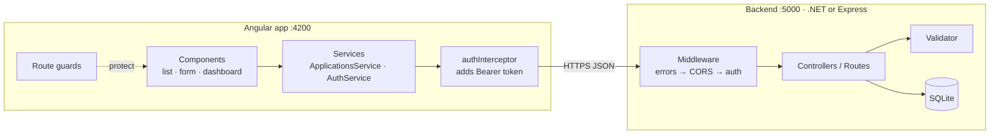
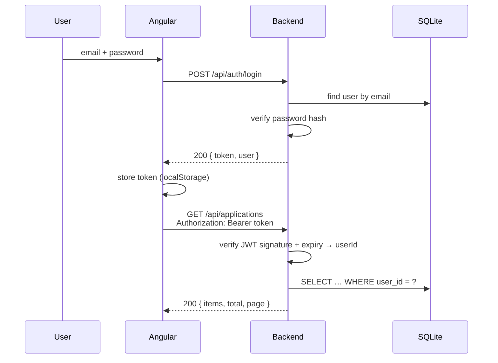
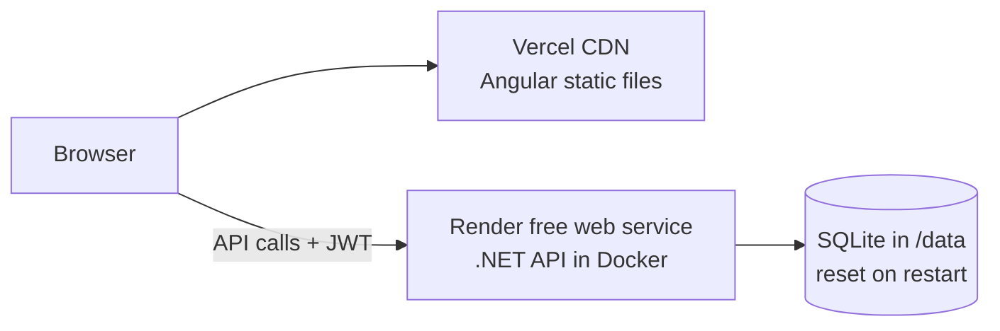

# JobTracker: full-stack job application tracker

Track every job you apply to: company, role, status, salary, dates and notes, with search, filters, pagination and a stats dashboard.

**One Angular frontend, two interchangeable backends with the same API:**

| Folder | Stack |
|---|---|
| `frontend-angular/` | Angular 19, TypeScript, RxJS, Signals, Reactive Forms, Router, HTTP interceptor |
| `backend-dotnet/` | ASP.NET Core Web API (.NET 10), EF Core + SQLite, JWT auth, PBKDF2 password hashing |
| `backend-node/` | Node.js + Express, SQLite (`node:sqlite`), JWT auth, scrypt password hashing |

## Live demo

- **App:** _add your Vercel URL here after deploying_
- **Demo login:** `demo@jobtracker.dev` / `Demo@12345`, or click **Try the demo account** on the login page

The API runs on Render's free tier. It sleeps after 15 minutes idle, so the first request can take up to a minute. Its SQLite data resets on restart, and the demo account is re-seeded automatically.

A shared **contract test** (`scripts/contract-test.mjs`, 32 checks) passes against either backend.

## Features

- Register and log in (JWT), with each user seeing only their own data
- Create, edit and delete applications, with validation on both client and server
- Search by company or role, filter by status, sort, paginate
- Dashboard: totals, offers, response rate and a status breakdown chart
- Global error handling, CORS, request logging, Dockerfiles

## Architecture



**Login flow**



## API contract (identical in both backends)

All `/api/applications` routes need `Authorization: Bearer <token>`.

| Method | URL | Success | Errors |
|---|---|---|---|
| POST | `/api/auth/register` `{name,email,password}` | 201 `{token,user}` | 400, 409 email taken |
| POST | `/api/auth/login` `{email,password}` | 200 `{token,user}` | 401 |
| GET | `/api/auth/me` | 200 user | 401 |
| GET | `/api/applications?status=&search=&sort=&order=&page=&pageSize=` | 200 `{items,page,pageSize,total}` | 400 bad status |
| GET | `/api/applications/stats` | 200 `{total,byStatus,responseRatePercent}` | |
| GET | `/api/applications/{id}` | 200 | 404 |
| POST | `/api/applications` | 201 + `Location` header | 400 `{error,details}` |
| PUT | `/api/applications/{id}` | 200 | 400, 404 |
| DELETE | `/api/applications/{id}` | 204 | 404 |

`sort` is one of `updatedAt` (default), `appliedOn` or `company`. `order` is `asc` or `desc`. `pageSize` is capped at 50.
`status` is one of `Wishlist`, `Applied`, `Interviewing`, `Offer` or `Rejected`.

## Run locally

Requirements: **.NET 10 SDK**, **Node.js 22.13+**.

**1. Start ONE backend**

```bash
cd backend-dotnet
dotnet run
```
or
```bash
cd backend-node
npm install
npm start
```

**2. Start the frontend** (new terminal)

```bash
cd frontend-angular
npm install
npm start
```

Then open **http://localhost:4200** and register an account.

**3. Verify the backend against the contract** (with a backend running)

```bash
node scripts/contract-test.mjs
```

**Node tests** (runs the contract in-process with an in-memory DB):

```bash
cd backend-node
npm test
```

**Docker** (one backend at a time):

```bash
docker compose --profile dotnet up --build
```

## Deployment



| Piece | Host | Config |
|---|---|---|
| .NET API | Render (Docker, free) | `render.yaml`: env vars `Jwt__Key` (generated), `Demo__Enabled=true`, `Cors__AllowedOrigin` = the Vercel URL |
| Angular | Vercel (static) | `frontend-angular/vercel.json`: Root Directory `frontend-angular`, env var `API_URL` = the Render URL |

## Project layout

```
backend-dotnet/
  Program.cs                 DI registrations + middleware pipeline
  Controllers/               AuthController, ApplicationsController
  Data/AppDbContext.cs       EF Core tables, indexes, relationships
  Models/ Dtos/              DB entities vs. JSON shapes
  Services/                  TokenService (JWT), ApplicationValidator
  Middleware/                global error handler
backend-node/
  src/app.js                 middleware pipeline (mirrors Program.cs)
  src/routes/                auth.js, applications.js (mirror the controllers)
  src/db.js                  schema in plain SQL
  src/services/ validation/  JWT, scrypt, validator
frontend-angular/src/app/
  core/                      models, services, interceptor, guards
  features/                  auth, applications (list + form), dashboard
  shared/                    status badge component
scripts/contract-test.mjs    32 API checks, works against either backend
```

See **STUDY_GUIDE.md** for the reading order and interview questions.
